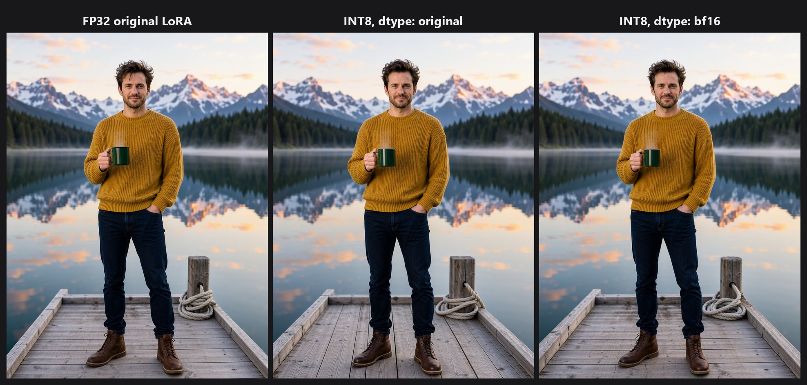
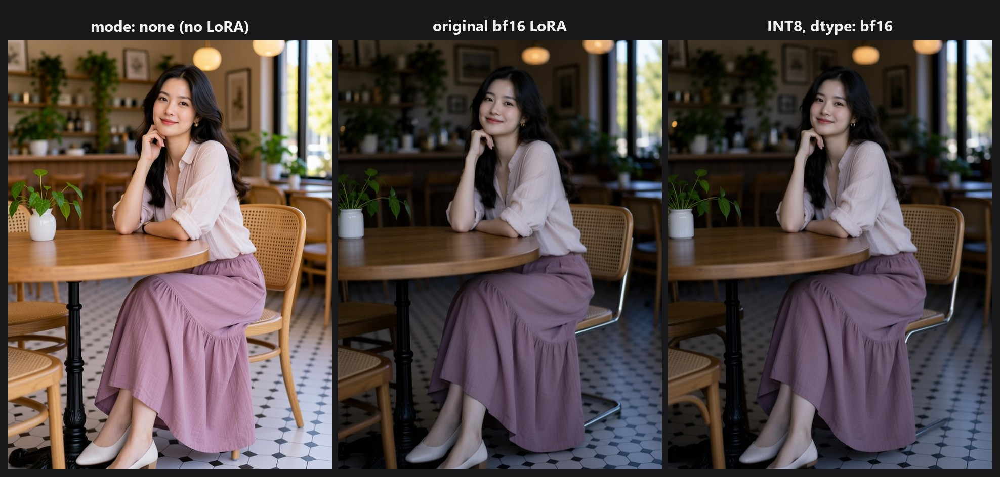
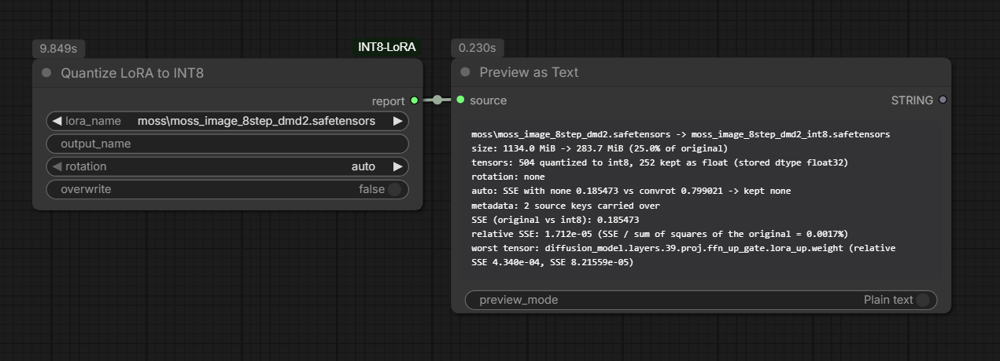
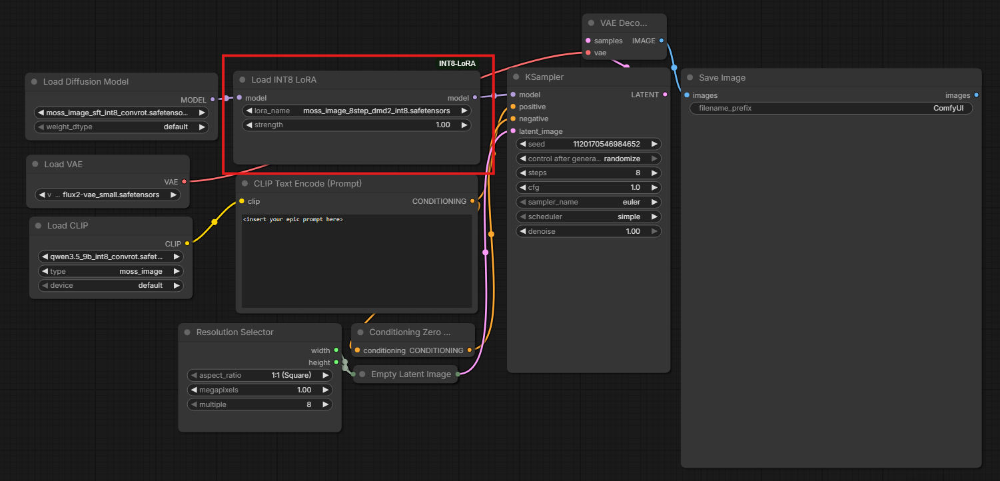
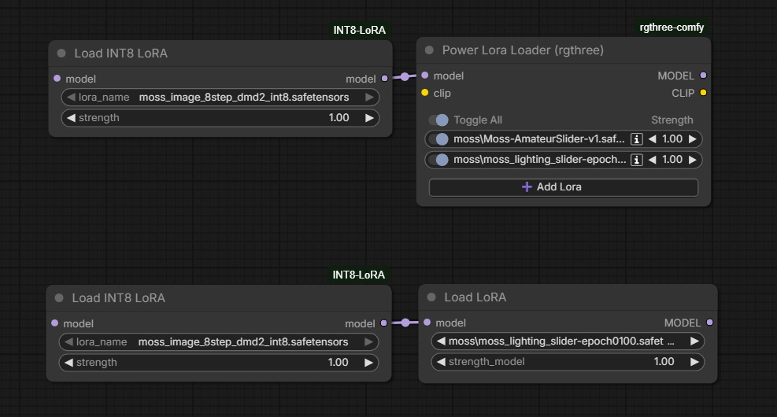
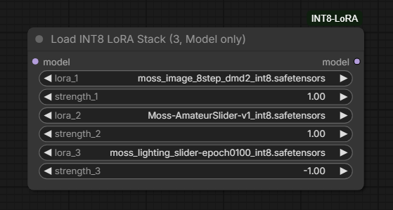
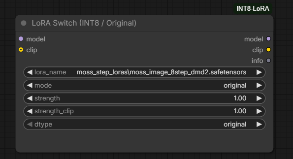

# ComfyUI-INT8-LoRA

Store LoRA / LoKr files as INT8 to shrink them on disk: about **half the size
for bf16/fp16 LoRAs and about a quarter for fp32 LoRAs**. Files are dequantized
in memory when loaded and applied through ComfyUI's normal LoRA path. Nothing in
ComfyUI is monkeypatched.

> **Heads up:** this node pack was written with AI assistance. I ran it on my own
> MOSS and Anima LoRAs and compared generations, and it comes with a unit test
> suite, but I can't promise it covers every setup. Please check results on your
> own LoRAs and keep your originals.

| Source dtype | Size after INT8 | Example (measured)      |
| ------------ | --------------- | ----------------------- |
| fp32         | ~25%            | 1134.0 MiB -> 283.7 MiB |
| bf16 / fp16  | ~50%            | 553.5 MiB -> 277.2 MiB  |

INT8 uses one byte per value against four (fp32) or two (bf16/fp16), plus a few
scale values and the small tensors that stay in float, so real files land a
fraction of a percent above the ideal 25% / 50%. **The saving is on disk, not in
memory:** once loaded, the LoRA is expanded back to float and held in RAM, and it
can use _more_ RAM than ComfyUI's stock loader (see Notes). The loaders' `dtype`
option, which defaults to `bf16`, reduces that for fp32 LoRAs.

## Showcase

The same prompt and seed, generated with the original fp32 8-step LoRA (left) and
its INT8 copy, restored as fp32 (middle) and as bf16 (right). The images are very
close; small details such as the hair or the position of the mug can differ (see the
FAQ):



Mixing loaders, with a negative strength: the 8-step LoRA goes through ComfyUI's
normal Load LoRA node, then a lighting LoRA at strength -1 (to reduce the lighting)
goes through the LoRA Switch node. Left: `mode` set to `none`, so no lighting LoRA is
applied and the scene is bright. Middle: the original bf16 file. Right: its INT8
copy with `dtype` bf16. Both lit versions are darker and moodier in the same way,
which shows the LoRA effect being applied, and the INT8 one is very close to the
original. That lighting LoRA is only about 2 MB, so the point here is the image, not
the size saving:



## Nodes (category `loaders/INT8 LoRA`)

- **Quantize LoRA to INT8** – pick a LoRA from `models/loras`, get an INT8 copy in
  `models/loras_int8`. It never modifies the source file and will not overwrite
  an existing output unless `overwrite` is on. The `report` output (connect it
  to a _Preview Any_ node, labelled _Preview as Text_ in newer ComfyUI; it is
  also logged to the console; `rotation` is `auto`, `none` or `convrot`) shows
  the size change and the SSE between the original and the INT8 factors.
- **Quantize LoRA Folder to INT8** – pick a subfolder of `models/loras` and every
  LoRA under it (including nested folders) is quantized in one run. The folder
  structure is kept under `models/loras_int8` (`styles/a.safetensors` becomes
  `styles/a_int8.safetensors`). Files that are not LoRAs, are already INT8,
  already have an INT8 copy (unless `overwrite` is on) or cannot be read are
  skipped and listed in the report with the reason; they never stop the batch.
  Only `.safetensors` files are processed. Cancelling the run stops after the
  current file.
- **Load INT8 LoRA** – one INT8 LoRA applied to the model only.
- **Load INT8 LoRA (Model + CLIP)** – one INT8 LoRA applied to both model and CLIP.
- **Load INT8 LoRA Stack (3, Model only)** – up to three INT8 LoRAs on the model;
  slots set to `None` are skipped.
- **LoRA Switch (INT8 / Original)** – for A/B comparisons. Pick a normal LoRA from
  `models/loras` and a `mode`: `int8` applies its INT8 copy, `original` applies the
  normal file, `none` applies no LoRA (a baseline). Change the dropdown and re-run
  with the same seed to compare. The INT8 copy is found by name: `<name>_int8.safetensors`
  in the same subfolder under `models/loras_int8` (what the folder node writes), or
  directly in that folder (what the single-file node writes). **The INT8 copy must
  already exist:** quantize the LoRA first with one of the quantize nodes, then
  refresh (press `R`). It also takes an optional `clip` with `strength_clip`, and
  its `info` output says which file was used.

The three loaders and the switch have an optional `dtype` input (`original`, `bf16`,
`fp16`, `fp32`) that sets the float type the INT8 values are restored to. **The
default is `bf16`:** an fp32 LoRA is restored as bf16 (half the RAM), a LoRA already
stored as bf16 is unchanged, and an fp16 LoRA is converted to bf16 (slightly less
precision). Choose `original` to restore exactly the dtype the LoRA was stored in.
(The switch uses `dtype` for the INT8 copy only; the original file is loaded as it
is, so for the closest comparison set the switch's `dtype` to `original`.)

**After quantizing, refresh the node definitions** (press `R` in ComfyUI, or reload
the page) so the new INT8 files show up in the INT8 loaders' dropdowns. Those
lists are read when ComfyUI loads the node definitions, so files created while
ComfyUI is running are not listed until you refresh.

INT8 files are kept in their own folder, so they do not appear in stock LoRA
loaders (including rgthree's Power Lora Loader), which cannot read them.

**Mix and match.** INT8 LoRAs and normal LoRAs can be used together. The INT8
loaders output an ordinary `MODEL`, so you can chain them with the stock **Load
LoRA** node, rgthree's **Power Lora Loader** or any other LoRA loader, in either
order. The screenshot below has the INT8 loader first, with its `model` output
connected to the next loader. Use INT8 files for the LoRAs you want to store
smaller and keep the rest as they are.

## Screenshots

Quantizing a LoRA. The report shows the size change, which rotation `auto`
kept, and the error:



Quantizing a whole subfolder (four LoRAs, 4536 MiB down to 1135 MiB, with the
per-file report):


Using an INT8 LoRA in a workflow (the red box marks the INT8 loader):



Mixing INT8 and normal LoRAs: the INT8 loader feeds its `model` output into
rgthree's Power Lora Loader (top) or into the stock Load LoRA node (bottom),
which apply the regular LoRAs on top:



Stacking three INT8 LoRAs in one node (strengths can be negative, as in
ComfyUI's own loaders):



Comparing a LoRA with its INT8 copy: the switch node's `mode` chooses `int8`,
`original` or `none`, and `info` reports which file was used. Change `mode`, keep
the seed, and run again. **You need to quantize the LoRA to INT8 first** (with the
Quantize LoRA to INT8 or Quantize LoRA Folder to INT8 node); the switch can't use
`int8` mode until that INT8 copy exists:



## Example workflows

[`example_workflows/int8_lora_reference.json`](https://raw.githubusercontent.com/bakapotatolord/ComfyUI-INT8-LoRA/main/example_workflows/int8_lora_reference.json)
shows where **Load INT8 LoRA** goes in a text-to-image graph. ComfyUI picks up
workflows from a custom node's `example_workflows` folder as templates. It is a
reference, not something that runs as-is: it uses the author's model files
(`moss_image_sft_int8_convrot`, `qwen3.5_9b_int8_convrot`, `flux2-vae_small`),
so swap in your own models and convert your LoRA first.

[`example_workflows/int8_lora_switch_reference.json`](https://raw.githubusercontent.com/bakapotatolord/ComfyUI-INT8-LoRA/main/example_workflows/int8_lora_switch_reference.json)
is the A/B version, built around the **LoRA Switch (INT8 / Original)** node. The seed
is fixed, it uses 8 steps, and the switch starts in `original` mode, so it runs before
you have an INT8 copy. To compare: enable the **Quantize LoRA to INT8** node on the
left (it is bypassed in the file), run it once, press `R` to refresh, then set the
switch's `mode` to `int8` (or `none` for a no-LoRA baseline) and run again. Like the
first one, it uses the author's model and LoRA names, so swap in your own.

## Notes

- **This is a storage saving, and it can cost RAM.** The INT8 loaders expand the
  whole LoRA back to float as soon as they run and hold it in RAM. ComfyUI's stock
  LoRA loader, as far as I can tell, reads the file lazily (memory-mapped), so a
  LoRA costs it almost nothing until it is applied. In one test with an fp32
  8-step LoRA (1134 MiB, one run per case) the INT8 loader with `dtype` set to
  `original` added about 1137 MiB right after loading, and ended the run about 1.1 GB
  above the stock loader. The benefit is smaller files on disk and less to store,
  copy or download, not lower memory use.
- **The `dtype` option (default `bf16`).** Loading an fp32 LoRA as `bf16` (or
  `fp16`) halves the RAM the loaded LoRA holds: in the same test the INT8 loader
  added about 568 MiB with `bf16` instead of 1137 MiB, and finished about 0.5 to
  0.7 GB above the stock loader instead of 1.1 GB. LoRAs already stored as bf16
  are not affected by the default. ComfyUI casts a LoRA's matrices to float32 one layer at
  a time while applying it, so this does not change the precision of the patching
  math. `bf16` is the safer choice: its rounding error is small next to the INT8
  quantization error, but check your own images. `fp16` has a narrower range and can
  lose very small values. Tensors that were
  not quantized (alphas, tiny factors) keep their own dtype.
- The report's SSE compares the stored factors (up/down, LoKr factors) with their
  INT8 reconstruction, including the cast back to the stored dtype. It does
  not measure error on the final weight change or on generated images, so
  check images before deleting an original.
- Tensors under 1024 elements, alphas and `dora_scale` stay in float.
- The source file's header metadata (kohya `ss_*` training info, trigger words,
  model spec fields) is copied into the INT8 file, and the loaders hand it to
  ComfyUI the same way the stock LoRA loader does. Some nodes read it, for
  example in-context LoRAs. Older ComfyUI versions without that argument just
  skip it. Only `.safetensors` sources have metadata to copy.
- **Rotation.** `convrot` applies a Hadamard rotation (same construction as
  PotatoForge's ConvRot) before quantizing. It helps LoRAs with a few large
  outlier values and does nothing or slightly hurts others, so the default,
  `auto`, quantizes both ways and keeps whichever has the lower total SSE
  (`none` on a tie). The report shows both SSE values. `none` and `convrot`
  force one choice. The rotation is undone when the file is loaded, so it does
  not change what ComfyUI sees.

See [FORMAT.md](FORMAT.md) for the file layout.

## FAQ

**Does it save VRAM or RAM?**
No. It saves disk space. The INT8 loaders expand the LoRA to float in RAM when
they run, so they can use more RAM than ComfyUI's stock loader (about the LoRA's
full float size in my test with an fp32 LoRA). The default `dtype` of `bf16` halves
that for an fp32 LoRA (about 0.5 to 0.7 GB above the stock loader instead of 1.1 GB
in my test). I haven't measured VRAM. See Notes.

**How do I compare an INT8 LoRA with the original?**
Use the **LoRA Switch (INT8 / Original)** node:

1. **Run a quantize node first.** The switch does not create anything: its `int8`
   mode needs an INT8 copy of the LoRA that already exists in `models/loras_int8`.
   Run **Quantize LoRA to INT8** (or the folder node) on the LoRA once, then press
   `R` to refresh. Without this, `int8` mode stops with an error that says so.
2. Pick the normal LoRA in the switch, set `mode` to `int8`, and generate with a
   fixed seed.
3. Change `mode` to `original` (and `none` for a no-LoRA baseline) and generate
   again.

For the closest comparison set the switch's `dtype` to `original`, so an fp32 LoRA
isn't also rounded to bf16. For both images in one run, use two switch nodes with
different modes feeding two samplers.

**Is it faster?**
No speed bonus while generating: the LoRA is expanded to float and applied the
normal way. Loading time can differ slightly (a smaller file to read, plus a short
dequantize step); I haven't measured it. A real speedup would need a separate
INT8 LoRA kernel, which this project doesn't have.

**Does image quality change?**
The INT8 values are an approximation of the original, and those small numerical
differences can change details in a generated image. With the same seed the
composition and pose were kept in my tests, but things like clothing, props or
facial features sometimes changed. Quality, though, seems to hold from my testing
(MOSS and Anima LoRAs): I saw no artifacts, noise or loss of sharpness. The
quantizer reports how far the INT8 version is from the original (SSE). Check your
own LoRAs and keep your originals until you've compared a few generations.

**Which LoRAs work?**
LoRA and LoKr files, tested on MOSS and Anima LoRAs in fp32 and bf16. Any large
float matrix in a file is quantized the same way, so other adapter types may well
work, but I haven't tested them.

**I quantized a LoRA but it isn't in the loader's dropdown.**
Press `R` in ComfyUI (or reload the page) to refresh the node definitions. The
dropdowns are read when ComfyUI loads them.

**Why don't the INT8 files show up in my normal LoRA loader or Power Lora Loader?**
They are saved in their own folder, `models/loras_int8`, and stock loaders can't
read them. Use the INT8 loaders and chain them into your other loaders.

**Can I mix INT8 and normal LoRAs?**
Yes. The INT8 loaders output a normal `MODEL`, so chain them with the stock Load
LoRA node, Power Lora Loader or any other LoRA loader, in either order.

**How do I update?**
If you cloned the repo, run `git pull` inside
`ComfyUI/custom_nodes/ComfyUI-INT8-LoRA` and restart ComfyUI. If you installed it
from ComfyUI Manager, update it there. The Changes section below lists what is new.

**Does it change or delete my original LoRA?**
No. The source file is only read. The INT8 copy is a new file in
`models/loras_int8`.

**What is `rotation` / `auto`?**
An optional Hadamard rotation applied before quantizing. It helps LoRAs with a few
large outlier values. `auto` (the default) tries both ways and keeps whichever has
the lower error.

**Why was a file skipped in folder mode?**
The folder node skips files that aren't `.safetensors`, don't look like a LoRA,
are already INT8, or already have an INT8 copy (unless `overwrite` is on). The
report lists each skipped file with its reason.

## Changes

### 0.3.0 (unreleased)

- New optional `dtype` input on all three loaders (`original`, `bf16`, `fp16`,
  `fp32`) to choose the float type the INT8 values are restored to. The default is
  `bf16`, which halves the RAM a loaded fp32 LoRA holds (LoRAs already stored as
  bf16 are unchanged; use `original` to keep exactly the stored dtype).
- README: corrected the memory notes. In my measurements the INT8 loaders hold the
  expanded LoRA in RAM and can use more RAM than the stock loader.
- README: clarified that small numerical differences can change details of
  generated images (clothing, props, features) while quality seems to hold.
- New node **LoRA Switch (INT8 / Original)** for A/B comparisons: one dropdown
  switches a LoRA between its INT8 copy, the original file and no LoRA.
- Fixed: the two quantize nodes now re-run when the files involved change (a LoRA
  added under the folder, an output deleted, a source edited). Before, ComfyUI
  replayed the cached report and nothing happened. With nothing changed they still
  stay cached.
- Fixed: cancelling a folder run now stops the batch on older ComfyUI versions too.
  There, the cancel was recorded as one skipped file and the run carried on.
- Added the FAQ and Changes sections to the README, including how to compare INT8
  with the original and how to update.

### 0.2.0 (2026-11-19)

- New node **Quantize LoRA Folder to INT8**: quantizes every LoRA under a
  subfolder (including nested folders), keeps the folder structure, and skips files
  that aren't LoRAs, are already INT8, already have an output or can't be read.
- Added an example workflow and screenshots, and updated the registry
  description and display name.

### 0.1.0 (2026-11-18)

- First release: **Quantize LoRA to INT8**, **Load INT8 LoRA**, **Load INT8 LoRA
  (Model + CLIP)** and **Load INT8 LoRA Stack**.
- Per-row/column INT8 scales, optional ConvRot rotation with `auto` selection, an
  error report, and source metadata carried over into the INT8 file.

## Tests

```bash
python -m unittest discover -s tests
```

## License

Copyright (C) 2026 bakapotatolord

This program is free software: you can redistribute it and/or modify it under
the terms of the GNU General Public License as published by the Free Software
Foundation, either version 3 of the License, or (at your option) any later
version. It is distributed in the hope that it will be useful, but WITHOUT ANY
WARRANTY. See the [LICENSE](LICENSE) file for the full text.
