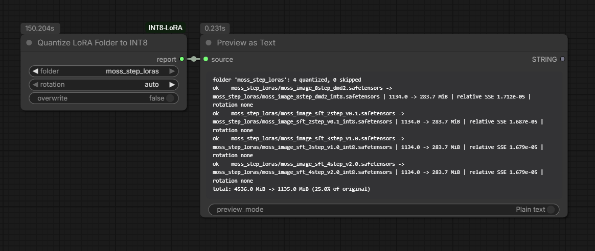

# ComfyUI-INT8-LoRA

Store LoRA / LoKr files as INT8 to shrink them on disk: about **half the size
for bf16/fp16 LoRAs and about a quarter for fp32 LoRAs**. Files are dequantized
in memory when loaded and applied through ComfyUI's normal LoRA path. Nothing in
ComfyUI is monkeypatched.

| Source dtype | Size after INT8 | Example (measured) |
| --- | --- | --- |
| fp32 | ~25% | 1134.0 MiB -> 283.7 MiB |
| bf16 / fp16 | ~50% | 553.5 MiB -> 277.2 MiB |

INT8 uses one byte per value against four (fp32) or two (bf16/fp16), plus a few
scale values and the small tensors that stay in float, so real files land a
fraction of a percent above the ideal 25% / 50%. The saving is on disk only: once
loaded, the LoRA is expanded back to float, so RAM and VRAM use are the same as
with the original.

## Nodes (category `loaders/INT8 LoRA`)

- **Quantize LoRA to INT8** – pick a LoRA from `models/loras`, get an INT8 copy in
  `models/loras_int8`. It never modifies the source file and will not overwrite
  an existing output unless `overwrite` is on. The `report` output (connect it
  to a _Preview Any_ node, labelled _Preview as Text_ in newer ComfyUI; it is
  also logged to the console; `rotation` is `auto`, `none` or `convrot`) shows
  the size change and the SSE between the original and the INT8 factors.
- **Quantize LoRA Folder to INT8** – pick a subfolder of `models/loras` and every
  LoRA under it (including nested folders) is quantized in one run. The folder
  structure is kept under `models/loras_int8` (`styles/a.safetensors` becomes
  `styles/a_int8.safetensors`). Files that are not LoRAs, are already INT8,
  already have an INT8 copy (unless `overwrite` is on) or cannot be read are
  skipped and listed in the report with the reason; they never stop the batch.
  Only `.safetensors` files are processed. Cancelling the run stops after the
  current file.
- **Load INT8 LoRA** – one INT8 LoRA applied to the model only.
- **Load INT8 LoRA (Model + CLIP)** – one INT8 LoRA applied to both model and CLIP.
- **Load INT8 LoRA Stack (3, Model only)** – up to three INT8 LoRAs on the model;
  slots set to `None` are skipped.

**After quantizing, refresh the node definitions** (press `R` in ComfyUI, or reload
the page) so the new INT8 files show up in the INT8 loaders' dropdowns. Those
lists are read when ComfyUI loads the node definitions, so files created while
ComfyUI is running are not listed until you refresh.

INT8 files are kept in their own folder, so they do not appear in stock LoRA
loaders (including rgthree's Power Lora Loader), which cannot read them.

**Mix and match.** INT8 LoRAs and normal LoRAs can be used together. The INT8
loaders output an ordinary `MODEL`, so you can chain them with the stock **Load
LoRA** node, rgthree's **Power Lora Loader** or any other LoRA loader, in either
order. The screenshot below has the INT8 loader first, with its `model` output
connected to the next loader. Use INT8 files for the LoRAs you want to store
smaller and keep the rest as they are.

## Screenshots

Quantizing a LoRA. The report shows the size change, which rotation `auto`
kept, and the error:


Quantizing a whole subfolder (four LoRAs, 4536 MiB down to 1135 MiB, with the
per-file report):



Using an INT8 LoRA in a workflow (the red box marks the INT8 loader):


Mixing INT8 and normal LoRAs: the INT8 loader feeds its `model` output into
rgthree's Power Lora Loader (top) or into the stock Load LoRA node (bottom),
which apply the regular LoRAs on top:


Stacking three INT8 LoRAs in one node (strengths can be negative, as in
ComfyUI's own loaders):


## Example workflow

[`example_workflows/int8_lora_reference.json`](https://raw.githubusercontent.com/bakapotatolord/ComfyUI-INT8-LoRA/main/example_workflows/int8_lora_reference.json)
shows where **Load INT8 LoRA** goes in a text-to-image graph. ComfyUI picks up
workflows from a custom node's `example_workflows` folder as templates. It is a
reference, not something that runs as-is: it uses the author's model files
(`moss_image_sft_int8_convrot`, `qwen3.5_9b_int8_convrot`, `flux2-vae_small`),
so swap in your own models and convert your LoRA first.

## Notes

- **This saves storage, not memory.** INT8 files are expanded back to float when
  they are loaded, so VRAM and RAM use during generation are about the same as
  with the original LoRA. The benefit is smaller files on disk and less to
  store, copy or download.
- The report's SSE compares the stored factors (up/down, LoKr factors) with their
  INT8 reconstruction, including the cast back to the stored dtype. It does
  not measure error on the final weight change or on generated images, so
  check images before deleting an original.
- Tensors under 1024 elements, alphas and `dora_scale` stay in float.
- The source file's header metadata (kohya `ss_*` training info, trigger words,
  model spec fields) is copied into the INT8 file, and the loaders hand it to
  ComfyUI the same way the stock LoRA loader does. Some nodes read it, for
  example in-context LoRAs. Older ComfyUI versions without that argument just
  skip it. Only `.safetensors` sources have metadata to copy.
- **Rotation.** `convrot` applies a Hadamard rotation (same construction as
  PotatoForge's ConvRot) before quantizing. It helps LoRAs with a few large
  outlier values and does nothing or slightly hurts others, so the default,
  `auto`, quantizes both ways and keeps whichever has the lower total SSE
  (`none` on a tie). The report shows both SSE values. `none` and `convrot`
  force one choice. The rotation is undone when the file is loaded, so it does
  not change what ComfyUI sees.

See [FORMAT.md](FORMAT.md) for the file layout.

## Tests

```bash
python -m unittest discover -s tests
```

## License

Copyright (C) 2026 bakapotatolord

This program is free software: you can redistribute it and/or modify it under
the terms of the GNU General Public License as published by the Free Software
Foundation, either version 3 of the License, or (at your option) any later
version. It is distributed in the hope that it will be useful, but WITHOUT ANY
WARRANTY. See the [LICENSE](LICENSE) file for the full text.
